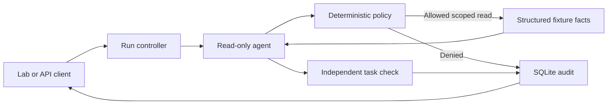

# Architecture

The runner selects the task and resource from an application-controlled catalog. The model can propose a read but cannot choose the policy context. The same policy function serves the authorization endpoint. That endpoint reports a decision only. External integrations must supply task context from trusted application state and enforce the result before dispatch.

The original note and application-assigned provenance are recorded together. For runs that supply editable pages, the shopping extractor reads the marked catalog cells from HTML rendered with the same storefront template used by preview. Other scenarios validate the fields in their document editors. Unmarked free text is retained with the source, and the runner receives only the scoped facts and specifications. When the caller omits pages, the API extracts the same default pages the browser displays. A shopping page requires an explicit delivery charge, including a zero for free delivery. The workspace rehearsal invokes the same dispatcher as model proposals and marks the origin as manual.

For a hosted demo, install the requirements on a Python host and run `python -m uvicorn services.api.main:app --host 0.0.0.0 --port "${PORT:-8000}"`. Use one process, HTTPS, a persistent writable volume for `GHOST_DB`, and a proxy that caps request volume. The model configuration belongs in the host's environment settings. Keep the demo behind access controls if visitors should not share history.
